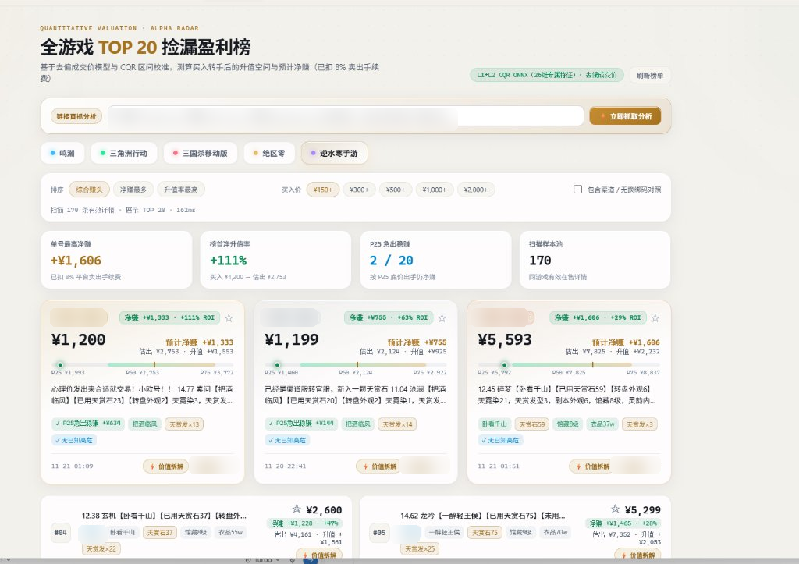
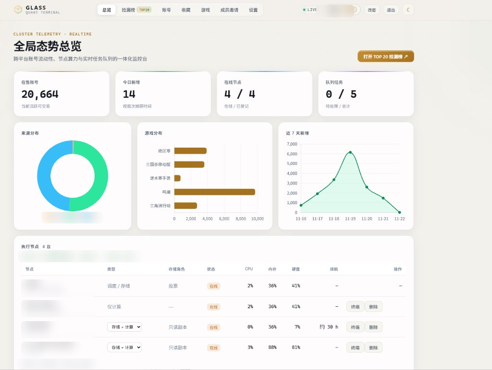
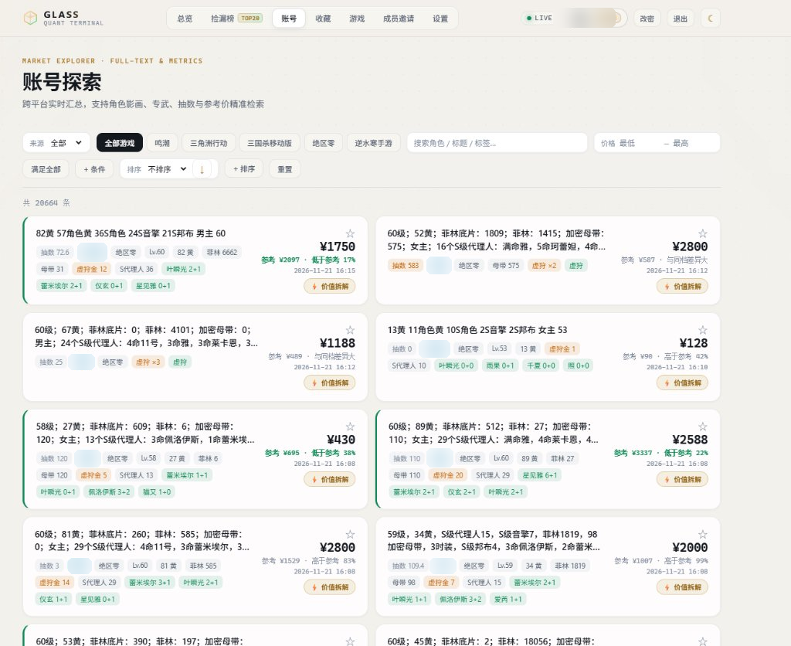
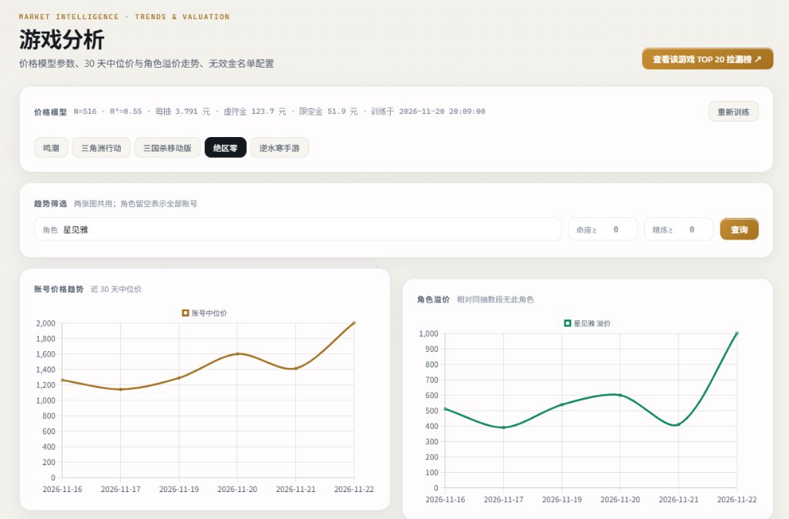
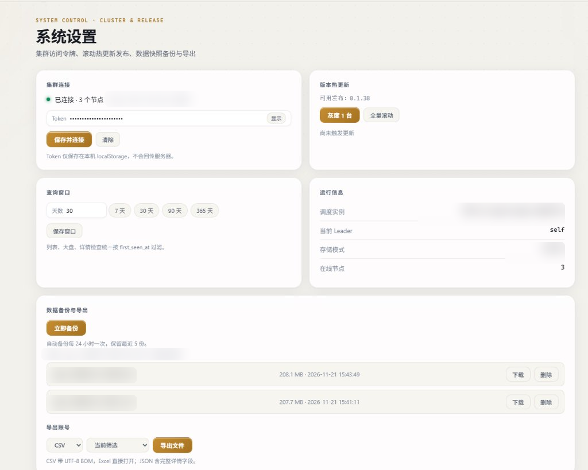

# GLASS Quant Terminal — Web Frontend

**GLASS** 是一款面向虚拟游戏资产的量化估值与套利雷达前端终端，采用 **Obsidian Atelier（黑曜暗色）/ Porcelain Light（宣纸亮色）** 双主题视觉体系，纯原生 HTML / CSS / ES6 构建，零构建步骤、开箱即用。

> 本仓库为 **公开前端展示版**，已对后端采集链路、平台协议、分布式集群运维与模型训练基础设施完全解耦与脱敏；内置纯前端 **Demo 沙盒模式**，可直接本地打开或部署到 GitHub Pages 交互体验。

## 核心特性

- **TOP 20 捡漏盈利雷达**：按转手升值与扣费后预计净赚（默认扣 8% 交易手续费）排序，支持「综合赚头 / 净赚最多 / 升值率最高」三维度切换，内置 CQR `[P25 — P50 — P75]` 置信区间尺与「P25 急出稳赚」信号。
- **单账号反事实价值拆解（Waterfall）**：以瀑布条直观展示基础底盘、存量资源、核心资产与风控折价的精确人民币构成（加总严格等于去偏公允价），并展示核心角色单点边际身价。
- **链接直抓分析入口**：粘贴商品链接即可调用后端自动识别分类并弹出完整价值拆解面板。
- **邀请制三级权限体系（Admin / VIP / Member）**：
  - `Admin`：全功能 + 邀请码签发/审计/作废 + 成员角色与会话管理。
  - `VIP`：完整 TOP 20 盈利榜 + 单账号价值拆解 + 链接分析 + 30 天市场价格/溢价趋势。
  - `Member`：账号探索 + 个人隔离收藏 + TOP 5 盈利榜预览（其余顺位与深度估值受权限保护）。
- **零外部字体阻塞**：全本地化无衬线与等宽字体栈，首屏秒开。

## 界面预览（已脱敏实机截图）

### 1. 全游戏 TOP 20 捡漏盈利榜 & 链接直抓分析
> 扣 8% 卖出手续费后测算预计净赚与净 ROI，附 CQR `[P25 — P50 — P75]` 价格区间尺与「P25 急出稳赚」信号。



### 2. 全局态势总览
> 跨渠道资产流动性、多游戏分布、近 7 天新增走势与实时节点态势。



### 3. 账号探索与参考价对比
> 支持多维度筛选、标签检索、参考价偏离度提示与单账号价值拆解入口。



### 4. 游戏价格趋势与角色溢价分析
> 近 30 天账号中位价与指定核心角色相对同抽数段的溢价走势。



### 5. 系统控制中心
> 滚动发布、查询窗口配置与数据快照导出界面。



## 快速预览（内置 Demo 模式）

仓库默认在 `config.js` 开启 `demoMode: true`，无需后端即可直接体验全部交互（支持一键切换 `Admin` / `VIP` / `Member` 三种角色，也可用演示邀请码 `GLS-VIP8-DEMO` / `GLS-MEM5-DEMO` 体验邀请注册流程）：

```bash
# 任意静态服务器启动即可
python -m http.server 8080
# 打开 http://localhost:8080
```

## 接入私有后端

修改 `config.js` 即可对接你的私有 GLASS API 服务：

```js
window.GLASS_CONFIG = {
  apiBase: 'https://your-private-api.example.com', // 同域部署留空 ''
  demoMode: false,
}
```

### 后端 REST 接口契约

| 模块 | 接口 | 说明 |
| :--- | :--- | :--- |
| 认证 | `GET /api/auth/status`, `POST /api/auth/{bootstrap,login,register,logout,password}`, `GET /api/auth/me` | HttpOnly Cookie 会话与邀请制注册 |
| 盈利榜 | `GET /api/games/{game}/bargains?limit=20&min_price=150&sort_by=composite` | 返回 TOP N 盈利指标、CQR 区间与风控标记 |
| 价值拆解 | `GET /api/accounts/{id}/valuation` | 返回分模块价值瀑布与核心角色边际估值 |
| 链接分析 | `POST /api/analyze-url` | 按链接即时抓取归类并返回估值拆解 |
| 探索与收藏 | `GET /api/accounts`, `POST/DELETE /api/favorites/{id}` | 多条件检索与按用户隔离收藏 |
| 市场趋势 | `GET /api/games/{game}/price-trend`, `GET /api/price-model` | 近 30 天中位价与角色溢价曲线 |
| 邀请与成员 | `GET/POST/DELETE /api/admin/invites`, `GET/PATCH /api/admin/users` | 仅管理员可访问 |

## License

MIT
